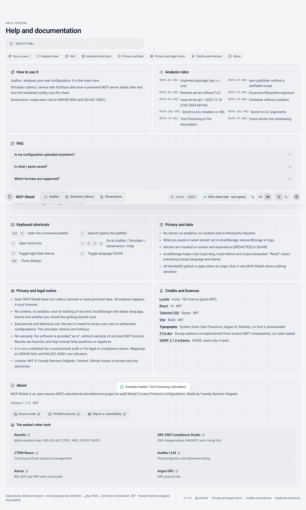
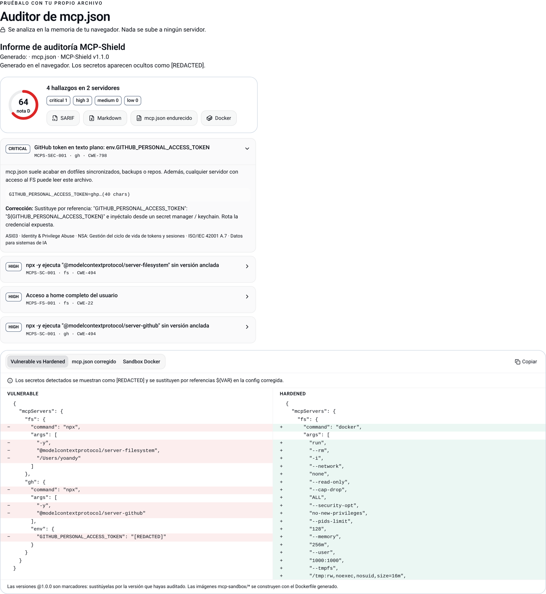

<h1 align="center">MCP-Shield</h1>

<p align="center"><b>Auditor de seguridad para configuraciones Model Context Protocol · simulador de kill-chain · matriz de gobernanza</b><br/>100% en el navegador, sin servidor y sin peticiones de red.</p>

<p align="center">
  <a href="https://heindall92.github.io/mcp-shield/"></a>
</p>
<p align="center">
  <a href="LICENSE"></a>
  <a href="https://github.com/heindall92/mcp-shield/actions/workflows/pages.yml"></a>
  
  
  
  
  
</p>

<p align="center"></p>

MCP-Shield revisa el `mcp.json` de Claude Desktop, Cursor o VS Code y te dice qué servidores MCP te ponen en riesgo: paquetes sin versión fijada, acceso a `~/.ssh` o a todo el disco, contenedores sin aislamiento, secretos en texto plano y descripciones de herramientas envenenadas. Para cada hallazgo propone la corrección y genera una configuración endurecida, un sandbox Docker y exportes SARIF y Markdown. **Tu configuración no sale del navegador** y los secretos se ocultan en pantalla y en cada exporte.

> Proyecto educativo y defensivo. Los ataques del simulador y todas las claves de ejemplo (`sk-FAKE-…`, `ghp_FAKE…`) son ficticios.

```text
mcp-shield:~$ cat mcp-shield.yaml
├─ entrada:     mcpServers · servers (.vscode) · mcp.servers · JSONC · BOM · límite 1 MiB / 500 servidores
├─ reglas:      10 (supply chain 3 · filesystem 3 · secretos 2 · tool poisoning 2)
├─ salidas:     SARIF 2.1.0 · Markdown · mcp.json endurecido (${VAR}) · Dockerfile + compose · impresión/PDF
├─ gobernanza:  OWASP Agentic Top 10 2026 · NSA MCP CSI · ISO/IEC 42001 · CSA (mapeo orientativo)
├─ aplicación:  React 19 · TypeScript · Vite · Tailwind CSS 3 · Lucide
├─ pruebas:     vitest 160 · Playwright + axe-core (4 vistas × 2 temas × 2 idiomas) · esquema SARIF oficial
╰─ seguridad:   CSP connect-src 'none' · referrer no-referrer · cero terceros · secretos nunca persistidos
version: 1.1.0 · licencia: MIT
```

---

## Índice

- [Cómo se usa](#cómo-se-usa)
- [Vistas](#vistas)
- [Capturas](#capturas)
- [Arranque rápido](#arranque-rápido)
- [Arquitectura](#arquitectura)
- [Reglas](#reglas)
- [Calidad](#calidad)
- [Seguridad y privacidad](#seguridad-y-privacidad)
- [Limitaciones conocidas](#limitaciones-conocidas)
- [Estructura](#estructura)
- [Licencia y créditos](#licencia-y-créditos)
- [Autor](#autor)
- [English](#english)

## Cómo se usa

1. Abre **https://heindall92.github.io/mcp-shield/**.
2. Pega tu configuración, suéltala sobre el editor o pulsa **Abrir archivo local** (`claude_desktop_config.json`, `.cursor/mcp.json`, `.vscode/mcp.json`). ¿Sin archivo a mano? **Cargar ejemplo de demo**.
3. Revisa los hallazgos: riesgo, evidencia (con secretos ocultos), ubicación y corrección.
4. Exporta **SARIF** (pestaña *Security* de GitHub) o **Markdown**, copia el `mcp.json` endurecido o imprime el informe.
5. **Reiniciar / dejar limpio** borra el texto, los resultados y los datos locales de la app (se conservan idioma y tema).

Atajos: <kbd>Ctrl</kbd>/<kbd>⌘</kbd>+<kbd>K</kbd> paleta de comandos · <kbd>/</kbd> buscar · <kbd>?</kbd> atajos · <kbd>1</kbd>–<kbd>4</kbd> vistas · <kbd>T</kbd> tema · <kbd>L</kbd> idioma · <kbd>Esc</kbd> cerrar.

## Vistas

| Vista | Para qué |
|---|---|
| **Auditor** (inicio) | Análisis de tu configuración real: risk score, hallazgos, diff *Vulnerable vs Hardened*, config corregida, sandbox Docker, exportes. |
| **Simulador (demo)** | Cuatro kill-chains con datos ficticios en tres paneles sincronizados (lo que ve el usuario, el JSON-RPC que recibe el modelo, el impacto en el host). Modo *Vulnerable* / *Hardened*. |
| **Gobernanza** | Cada regla mapeada a OWASP Agentic Top 10 2026, NSA MCP CSI, ISO/IEC 42001 y CSA, más incidentes reales verificados. |
| **Ayuda** | Buscador, uso, FAQ, reglas, atajos, privacidad, aviso legal, créditos y licencias, acerca de. |

## Capturas

| | |
|---|---|
|  |  |
| Inicio limpio y primeros pasos | Paleta de comandos (⌘K / Ctrl+K) |
|  |  |
| Auditor · tema claro · EN | Centro de ayuda |
|  |  |
| Simulador (demo educativa) | Informe para imprimir / PDF |

## Arranque rápido

```bash
git clone https://github.com/heindall92/mcp-shield.git && cd mcp-shield
npm ci
npm run dev      # http://localhost:5173/mcp-shield/
npm test         # vitest
npm run lint     # oxlint
npm run build    # dist/ (base /mcp-shield/)
```

El despliegue lo hace `.github/workflows/pages.yml` (tests → build → comprobación de egress → GitHub Pages) en cada push a `main`.

## Arquitectura

```text
mcp.json ──► parse.ts (JSONC, formatos, límites) ──► scanner.ts ──► 10 reglas ──► redact.ts
                                                         │                         │
                                                         ▼                         ▼
                                       remediator.ts (config ${VAR}, Docker)   UI · SARIF · Markdown · impresión
```

Todo es TypeScript puro en `src/engine/`, sin dependencias de ejecución salvo React y Lucide. La UI nunca guarda el texto pegado: vive en memoria.

## Reglas

| ID | Qué detecta |
|---|---|
| MCPS-SC-001 | `npx -y` / `uvx` / `bunx` / `pnpm dlx` sin versión exacta (incluye `cmd /c npx` y `npx.cmd`) |
| MCPS-SC-002 | Paquete npm sin scope de publisher verificable |
| MCPS-SC-003 | Servidor remoto por `http://` o `ws://` (excepto localhost) |
| MCPS-FS-001 | Acceso a `/`, `C:\`, home completo, `~/.ssh`, `~/.aws`, directorios de sistema (args, `-v`, `--mount`) |
| MCPS-FS-002 | `mcp-server-git` anterior a 2025.12.18 (CVE-2025-68144) |
| MCPS-FS-003 | Contenedor con `--privileged`, `--network host`, `--pid host`, socket de Docker; red abierta (bajo) |
| MCPS-SEC-001 | Secretos en `env`, `headers` (`Authorization: Bearer …`) o en la URL |
| MCPS-SEC-002 | Secretos en argumentos de línea de comandos |
| MCPS-TP-001 | Tool Poisoning: directivas ocultas, ocultación al usuario, ficheros sensibles, exfiltración, zero-width |
| MCPS-TP-002 | Cross-server tool shadowing |

Las cifras, CVE e incidentes están contrastados con fuentes primarias en [docs/SOURCES.md](docs/SOURCES.md).

## Calidad

- **160 pruebas vitest**: reglas, falsos positivos con configuraciones de la documentación oficial, parser (BOM, JSONC, formatos, tamaño, entradas no objeto), ocultación de secretos en cada salida, SARIF validado con el esquema OASIS, inyección Markdown, reset, paridad ES/EN y contraste WCAG AA en ambos temas.
- **Playwright + axe-core**: 0 violaciones WCAG 2 A/AA en Auditor, paleta, Ayuda, Gobernanza y Simulador, en claro/oscuro y ES/EN; cero peticiones externas; ningún secreto en `localStorage`.
- `oxlint` sin avisos. `npm audit --omit=dev`: 0 vulnerabilidades (los avisos restantes son de herramientas de desarrollo ligadas a Tailwind 3).

## Seguridad y privacidad

- **Sin servidor, analítica, cookies ni terceros.** Fuentes del sistema; nada se descarga después de cargar la página.
- **CSP** en `<meta>`: `default-src 'self'; script-src 'self'; connect-src 'none'; object-src 'none'; base-uri 'self'; form-action 'none'`, más `<meta name="referrer" content="no-referrer">`.
- **Secretos**: ocultos en pantalla, SARIF, Markdown, impresión y portapapeles; la config corregida usa referencias `${VAR}`. El texto pegado nunca se guarda ni se registra. `localStorage` solo contiene `mcps-lang`, `mcps-theme` y `mcps-onboarded`.
- **XSS**: React escapa toda salida; los exportes Markdown escapan HTML, `|` y backticks.
- **Cabeceras HTTP en GitHub Pages**: Pages no permite configurar cabeceras de respuesta ([github/pages-gem#415](https://github.com/github/pages-gem/issues/415)). GitHub ya envía `Strict-Transport-Security` (comprobado con `curl -I`), pero no es posible añadir `X-Frame-Options` ni `Content-Security-Policy` como cabecera, y `frame-ancestors` se ignora dentro de `<meta>` ([CSP3](https://www.w3.org/TR/CSP3/#meta-element)). La app no tiene acciones con estado que un *clickjacking* pueda aprovechar; si lo necesitas, sírvela tras un proxy (p. ej. Cloudflare) que añada esas cabeceras.
- Para informar de una vulnerabilidad: [SECURITY.md](SECURITY.md).

## Limitaciones conocidas

- Las reglas son **heurísticas**: puede haber falsos positivos y negativos. No sustituye a una auditoría profesional.
- La config corregida es un **punto de partida**: sustituye las versiones `@1.0.0`, construye las imágenes `mcp-sandbox/*` con el Dockerfile generado y adapta `${VAR}` a tu cliente (`${env:VAR}` en Cursor, `${input:id}` o `envFile` en VS Code; la documentación de Claude Desktop no describe interpolación).
- El mapeo de gobernanza es **orientativo**, no una certificación.
- El análisis no se conecta a los servidores: solo ve las descripciones de herramientas que incluyas en el JSON.
- Todas las apps de `heindall92.github.io` comparten origen; por eso MCP-Shield no guarda nada sensible.

## Estructura

```text
src/
  engine/        parse · scanner · rules/ · redact · remediator · sarifExporter · governance · simulation
  components/    auditor/ · simulator/ · governance/ · help/ · ui/ (paleta, toasts, diálogos, segmented)
  i18n/          ui.ts (ES/EN) · prefs · storage
  data/          escenarios, ejemplos de demo, incidentes
tests/           vitest + esquema SARIF oficial
docs/            SOURCES.md · DESIGN-REFERENCES.md · img/
```

## Licencia y créditos

MIT © Yoandy Ramírez Delgado. Iconos [Lucide](https://lucide.dev/license) (ISC; los derivados de Feather, MIT). React, Tailwind CSS y Vite (MIT). Patrones de diseño de 21st.dev reimplementados desde cero: [docs/DESIGN-REFERENCES.md](docs/DESIGN-REFERENCES.md). Cambios: [CHANGELOG.md](CHANGELOG.md).

El software se ofrece «tal cual», sin garantía. Úsalo solo con configuraciones propias o autorizadas.

## Autor

**Yoandy Ramírez Delgado** · ciberseguridad

<a href="https://github.com/heindall92"></a>
<a href="https://www.linkedin.com/in/yoandyrd92/"></a>
<a href="https://yoandyramirez.com"></a>

Otras herramientas: [Rosetta](https://heindall92.github.io/rosetta_multinorma/) · [GRC ENS Compliance Studio](https://heindall92.github.io/grc_ens_compliance_studio/) · [CTEM-Nexus](https://heindall92.github.io/ctem-nexus/) · [Auditor LLM](https://heindall92.github.io/auditor_llm/) · [Kairos](https://heindall92.github.io/kairos/) · [Argos GRC](https://heindall92.github.io/argos-grc/)

---

## English

**MCP-Shield** audits Model Context Protocol configurations (Claude Desktop, Cursor, VS Code) entirely in your browser: 10 rules for supply chain, filesystem, secrets and tool poisoning; a hardened `mcp.json` with `${VAR}` references; a Docker sandbox; SARIF 2.1.0 and Markdown exports; and a printable report. Secrets are masked everywhere and pasted text is never stored. It also ships an educational kill-chain simulator with fictitious data, a governance matrix (OWASP Agentic Top 10 2026, NSA MCP CSI, ISO/IEC 42001, CSA) and a help centre with a command palette (Ctrl/⌘+K) and keyboard shortcuts.

- Live: **https://heindall92.github.io/mcp-shield/**
- Security headers: GitHub Pages cannot set response headers. HSTS is sent by GitHub; `X-Frame-Options` and header-based CSP/`frame-ancestors` are not available, so the CSP is delivered via `<meta>` (with `connect-src 'none'`) plus a `no-referrer` policy.
- Not a substitute for a professional audit. Provided “as is” under the MIT licence. Report vulnerabilities via [SECURITY.md](SECURITY.md).
