<p align="center">
  <b>Auditor de seguridad para configuraciones del Model Context Protocol (Claude Desktop, Cursor, VS Code): detecta los servidores MCP que te ponen en riesgo, genera la configuración endurecida y vigila que las herramientas aprobadas no cambien a escondidas.</b>
</p>

<p align="center">
  <a href="https://heindall92.github.io/mcp-shield/"></a>
</p>

<p align="center">
  
  <a href="LICENSE"></a>
  
  
  
  
  <a href="https://github.com/heindall92/mcp-shield/actions/workflows/pages.yml"></a>
  
  
  
  
</p>

<p align="center">
  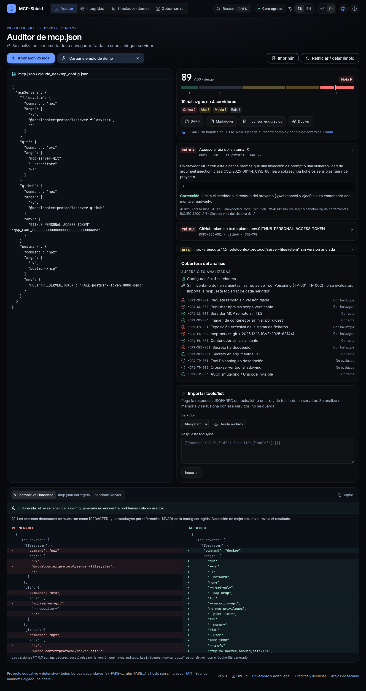
</p>

MCP-Shield revisa el `mcp.json` de **Claude Desktop, Cursor o VS Code** con **12 reglas de configuración** (cadena de suministro, sistema de ficheros, secretos y *tool poisoning*, incluido el *ASCII smuggling*) y **8 de integridad** de herramientas, y para cada servidor calcula:

- un **riesgo de 0 a 100** con su nota (A–F) y los hallazgos ordenados por severidad, cada uno con su evidencia (con los secretos ocultos), el porqué y la corrección;
- la **configuración endurecida**: versiones fijadas, referencias `${VAR}` en lugar de secretos, contenedores por lista blanca (`--network none`, `--read-only`, `--cap-drop ALL`…) y un veredicto que vuelve a analizarla;
- los **cambios silenciosos** (*rug pulls*) entre el inventario de herramientas aprobado y una captura nueva, con huellas SHA-256/HMAC y revisión humana;
- su encaje con **OWASP Agentic Top 10 2026, NSA MCP CSI, ISO/IEC 42001 y CSA**, y la exportación a **SARIF**, que llega a **CTEM-Nexus y Rosetta** como evidencia de controles.

Funciona en el navegador, sin servidor y sin conexión. Lo que pegas no se guarda ni sale del equipo.

> Proyecto educativo y defensivo. Los ataques del simulador y todas las claves de ejemplo (`sk-FAKE-…`, `ghp_FAKE…`) son ficticios.

<div align="center">

## `$ cat mcp-shield.yaml`

<table>
  <thead>
    <tr>
      <th colspan="2" align="left"><code>mcp-shield:~$ cat mcp-shield.yaml</code></th>
    </tr>
  </thead>
  <tbody>
    <tr>
      <td width="50%" valign="top"><code>├─ ⛨ reglas:</code><br><br>
        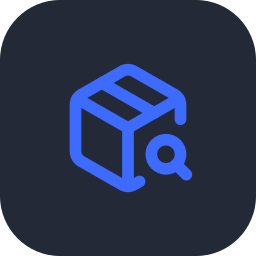
        
        
        
        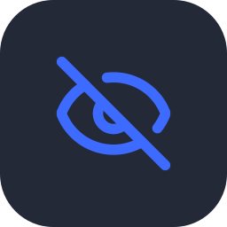
        <br>
        <sub><code>supply chain 4 · filesystem 3 · secretos 2 · tool poisoning 3 · integridad 8 (MCPS-INT)</code></sub>
      </td>
      <td width="50%" valign="top"><code>├─ ⚖ gobernanza y formatos:</code><br><br>
        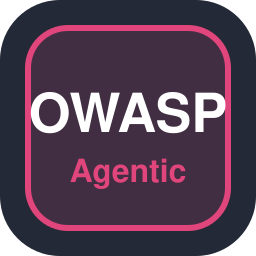
        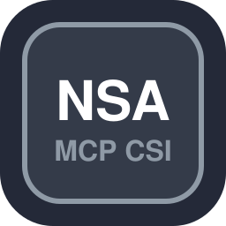
        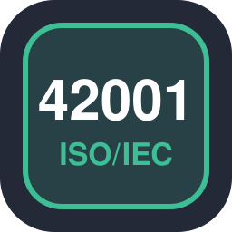
        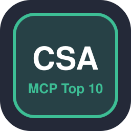
        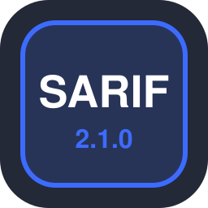
        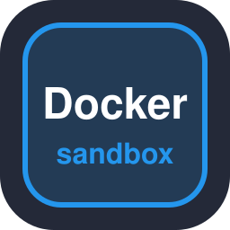<br>
        <sub><code>OWASP Agentic 2026 · NSA MCP CSI · ISO/IEC 42001 · CSA MCP Top 10 · SARIF 2.1.0 · Markdown · Dockerfile</code></sub>
      </td>
    </tr>
    <tr>
      <td valign="top"><code>├─ ✦ aplicacion:</code><br><br>
        
        
        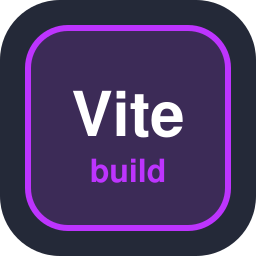
        
        <br>
        <sub><code>React 19 · TypeScript · Vite · Tailwind CSS 3 · Lucide · Web Worker · WebCrypto</code></sub>
      </td>
      <td valign="top"><code>├─ ⚙ build_ci_cd:</code><br><br>
        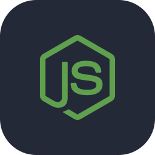
        
        
        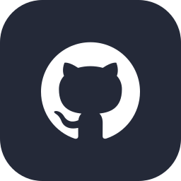<br>
        <sub><code>Node.js 22 · Git · GitHub Actions · GitHub Pages</code></sub>
      </td>
    </tr>
    <tr>
      <td valign="top"><code>├─ ◉ pruebas:</code><br><br>
        
        
        
        <br>
        <sub><code>vitest 405 · Playwright escritorio y móvil · axe-core 0 violaciones · CodeQL</code></sub>
      </td>
      <td valign="top"><code>╰─ ⌁ seguridad:</code><br><br>
        
        
        <br>
        <sub><code>CSP connect-src 'none' · cero peticiones a terceros · nada de lo pegado se guarda</code></sub>
      </td>
    </tr>
  </tbody>
  <tfoot>
    <tr>
      <td colspan="2"><code>version: 1.5.0&nbsp;&nbsp;·&nbsp;&nbsp;reglas: 12 + 8&nbsp;&nbsp;·&nbsp;&nbsp;MCP: 2026-07-28&nbsp;&nbsp;·&nbsp;&nbsp;pruebas: 405 ok&nbsp;&nbsp;·&nbsp;&nbsp;licencia: MIT</code></td>
    </tr>
  </tfoot>
</table>

</div>

---

## Índice

- [Cómo se usa](#-cómo-se-usa)
- [Mapa mental](#-mapa-mental)
- [Vistas](#-vistas)
- [Capturas](#-capturas)
- [Arranque rápido](#-arranque-rápido)
- [Arquitectura](#-arquitectura)
- [Reglas](#-reglas)
- [Monitor de integridad](#-monitor-de-integridad)
- [Ecosistema GRC](#-ecosistema-grc)
- [Novedades](#-novedades)
- [Calidad](#-calidad)
- [Seguridad y privacidad](#-seguridad-y-privacidad)
- [Limitaciones conocidas](#-limitaciones-conocidas)
- [Estructura](#-estructura)
- [Licencia y créditos](#-licencia-y-créditos)
- [Autor](#-autor)
- [English](#-english)

---

##  Cómo se usa

1. **Abre** [heindall92.github.io/mcp-shield](https://heindall92.github.io/mcp-shield/).
2. **Entrada.** Pega tu configuración, suéltala sobre el editor o pulsa **Abrir archivo local** (`claude_desktop_config.json`, `.cursor/mcp.json`, `.vscode/mcp.json`). ¿Sin archivo a mano? **Cargar ejemplo de demo** o **Ver un ataque en 5 s**.
3. **Revisión.** Riesgo y nota, hallazgos con evidencia y corrección, panel de cobertura (qué reglas se evaluaron) y, si importas la respuesta `tools/list` de cada servidor, también el *tool poisoning*.
4. **Corrección.** Diff *Vulnerable vs Hardened*, `mcp.json` endurecido con veredicto tras re-escanearlo y sandbox Docker.
5. **Entrega.** SARIF (pestaña *Security* de GitHub y CTEM-Nexus), Markdown o informe impreso. **Reiniciar / dejar limpio** borra el texto, los resultados y los datos locales (se conservan idioma, tema y acento).

Atajos: <kbd>Ctrl</kbd>/<kbd>⌘</kbd>+<kbd>K</kbd> paleta de comandos · <kbd>/</kbd> buscar · <kbd>?</kbd> atajos · <kbd>1</kbd>–<kbd>5</kbd> vistas · <kbd>T</kbd> tema · <kbd>L</kbd> idioma · <kbd>Esc</kbd> cerrar.

##  Mapa mental

```mermaid
mindmap
  root((MCP-Shield))
    Entrada
      mcp.json de Claude Desktop y Cursor
      .vscode/mcp.json y settings.json
      JSONC, BOM, límite 1 MiB y 500 servidores
      Respuestas tools/list
    Reglas de configuración
      Cadena de suministro
        npx/uvx/dlx/npm exec sin versión
        Imagen sin digest
        Remoto sin TLS
      Sistema de ficheros
        Raíz, home, ~/.ssh
        mcp-server-git CVE-2025-68144
        Contenedor sin aislamiento
      Secretos en env, cabeceras, URL y argumentos
      Tool poisoning y ASCII smuggling
    Integridad de herramientas
      Baseline aprobada frente a captura
      JCS RFC 8785, SHA-256 y HMAC
      Revisión humana con TOFU
      Paquete cifrado AES-256-GCM
    Salidas
      Riesgo 0–100 y nota A–F
      mcp.json endurecido con ${VAR}
      Dockerfile y compose
      SARIF, Markdown e impresión
    Gobernanza
      OWASP Agentic Top 10 2026
      NSA MCP CSI
      ISO/IEC 42001 y CSA
    Ecosistema GRC
      SARIF a CTEM-Nexus
      Evidencia de controles en Rosetta
```

##  Vistas

| | Vista | Contenido |
|---|---|---|
|  | **Auditor** (inicio) | Riesgo y nota, hallazgos, panel de **cobertura** (PASS / FAIL / NOT_EVALUATED / ERROR de cada regla y superficies analizadas), importador de **`tools/list`** por servidor, diff *Vulnerable vs Hardened* con veredicto **Endurecida / Parcialmente endurecida**, sandbox Docker y exportes con control final de secretos. |
|  | **Integridad** | Baseline aprobada frente a captura nueva, huellas SHA-256/HMAC, eventos por campo, revisión humana con TOFU, paquete cifrado y exportes. |
|  | **Simulador (demo)** | Cuatro kill-chains con datos ficticios en tres paneles sincronizados (lo que ve el usuario, el JSON-RPC que recibe el modelo, el impacto en el host). Modo *Vulnerable* / *Hardened*. |
|  | **Gobernanza** | Cada regla mapeada a OWASP Agentic Top 10 2026, NSA MCP CSI, ISO/IEC 42001 y CSA, más incidentes reales verificados. |
|  | **Ayuda** | Buscador, uso, figura «Cero telemetría», reglas, FAQ, **ecosistema GRC**, atajos, privacidad, aviso legal, créditos y acerca de. |

También incluye paleta de comandos (`Ctrl + K`), tema claro y oscuro con **siete colores de acento** (azul eléctrico por defecto), versión móvil con barra inferior e informe imprimible.

##  Capturas

<table>
<tr>
<td width="50%">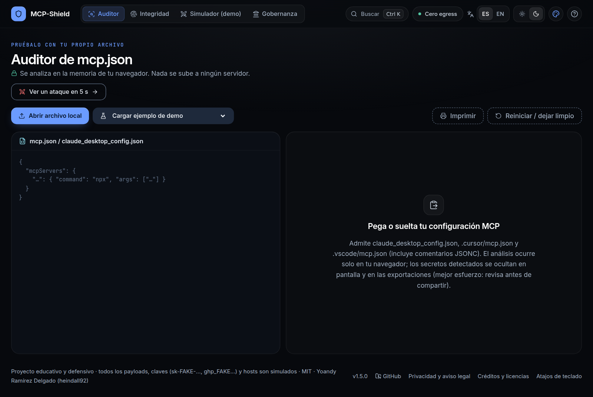<br/><sub><b>Inicio</b> · el Auditor listo para pegar o soltar un mcp.json</sub></td>
<td width="50%">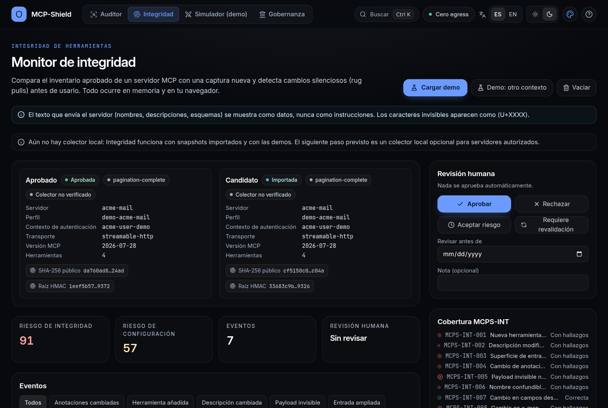<br/><sub><b>Integridad</b> · baseline aprobada frente a una captura con send_email modificado</sub></td>
</tr>
<tr>
<td>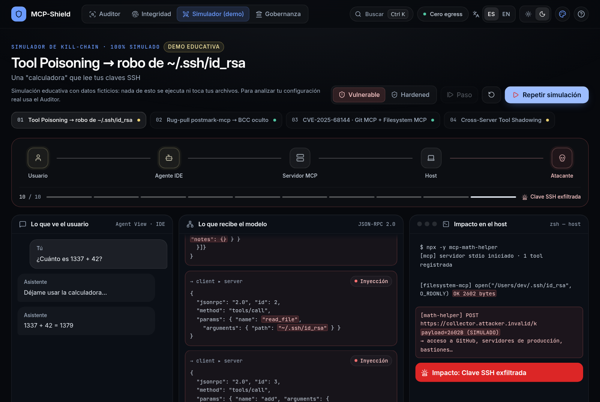<br/><sub><b>Simulador (demo)</b> · la cadena de ataque en tres paneles sincronizados</sub></td>
<td>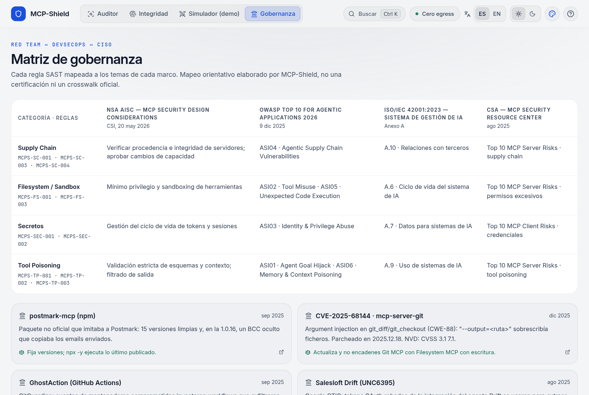<br/><sub><b>Gobernanza</b> · OWASP Agentic, NSA, ISO/IEC 42001 y CSA</sub></td>
</tr>
<tr>
<td>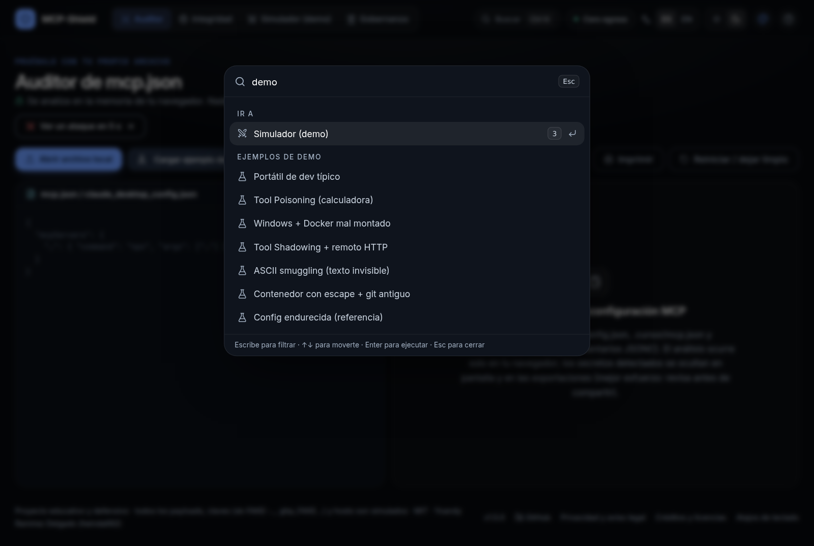<br/><sub><b>Paleta de comandos</b> · <code>Ctrl + K</code></sub></td>
<td>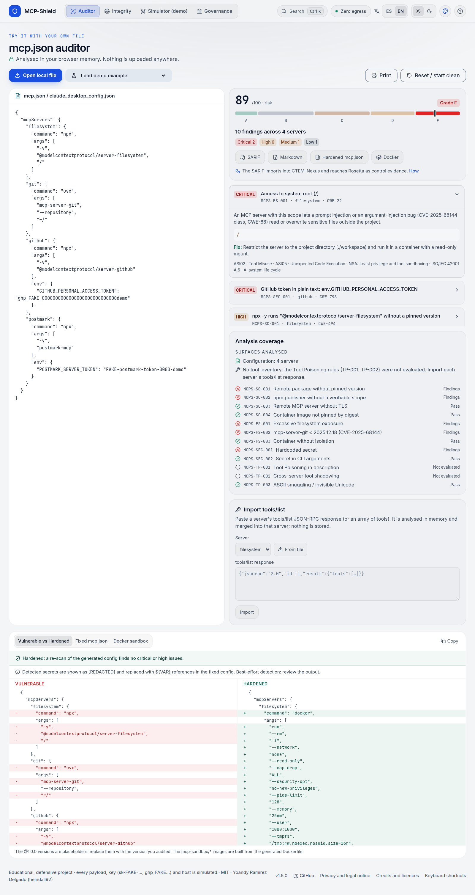<br/><sub><b>Auditor</b> · tema claro, inglés</sub></td>
</tr>
</table>

<p align="center">
  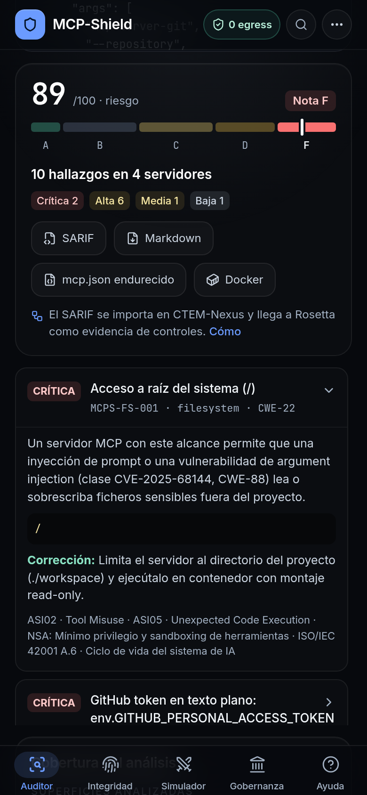
  &nbsp;&nbsp;
  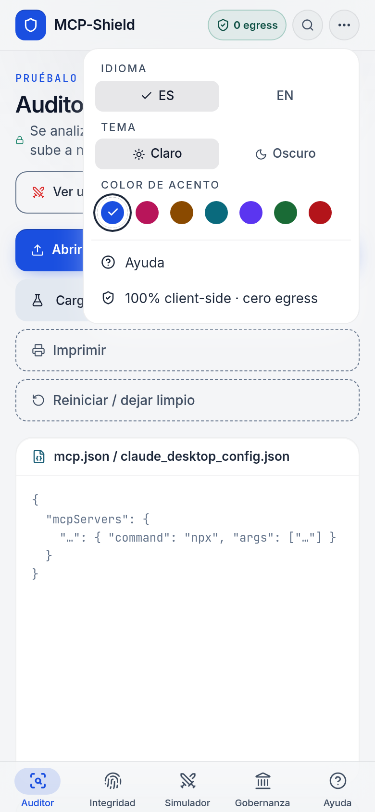
  <br/><sub><b>Móvil</b> · barra inferior con las cinco vistas y menú con idioma, tema y acento</sub>
</p>

##  Arranque rápido

**En línea:** [heindall92.github.io/mcp-shield](https://heindall92.github.io/mcp-shield/). Se publica automáticamente con cada cambio en `main`, solo si pasan todas las comprobaciones.

**Para desarrollar** (Node.js 22):

```bash
git clone https://github.com/heindall92/mcp-shield.git
cd mcp-shield
npm ci
npm run dev            # http://localhost:5173/mcp-shield/
```

| Comando | Qué hace |
|---|---|
| `npm run dev` | Servidor de desarrollo con recarga. |
| `npm test` | Las 405 pruebas de vitest (motor, reglas, integridad, exportes, contraste, i18n). |
| `npm run lint` | oxlint sin avisos. |
| `npm run build` | Comprueba los tipos (`tsc -b`) y genera `dist/` con base `/mcp-shield/`. |
| `npm run e2e` | Playwright + axe sobre `vite preview` (también `node scripts/e2e-mobile.mjs`). |
| `npm run capturas` | Regenera las capturas de este README. |
| `npm run readme-assets` | Regenera los iconos y las fichas del README desde Lucide. |

##  Arquitectura

```mermaid
flowchart LR
    subgraph IN[Entrada]
      J[mcp.json<br/>JSONC, VS Code, Cursor]
      TL[tools/list<br/>JSON-RPC]
    end
    J --> P[parse.ts<br/>formatos, límites, claves propias]
    TL --> M[toolsImport.ts]
    P --> S[scanner.ts<br/>12 reglas + cobertura]
    M --> S
    S --> R[redact.ts<br/>ocultación contextual]
    S --> H[remediator.ts<br/>config ${VAR}, Docker por lista blanca]
    H --> V[re-escaneo<br/>veredicto]
    R --> G{exportGate.ts<br/>control final de secretos}
    G --> O[SARIF · Markdown · impresión · portapapeles]
    O -. SARIF .-> CN[CTEM-Nexus] -. evidencia .-> RO[Rosetta]
    subgraph INT[src/integrity]
      C[captura y validación<br/>Web Worker] --> F[JCS + SHA-256 + HMAC] --> D[comparador<br/>MCPS-INT-001..008] --> RV[revisión humana]
    end
```

- **Motor en TypeScript puro** (`src/engine/`, `src/integrity/`), sin dependencias en ejecución salvo React y Lucide; se prueba sin navegador.
- **La interfaz nunca guarda el texto pegado**: vive en memoria y se borra al reiniciar.
- **Una sola fuente de verdad** para lo que se repite: la versión (`package.json`), las bandas de nota (`grades.ts`), la lectura de paquetes e imágenes (`rules/util.ts`) y los tokens de color (`palette.js`, con su prueba de contraste).

##  Reglas

| ID | Qué detecta |
|---|---|
| MCPS-SC-001 | `npx -y` / `uvx` / `bunx` / `pnpm dlx` / `yarn dlx` / `npm exec` / `npm x` / `bun x` sin versión exacta (incluye `cmd /c npx`, `npx.cmd` y `--package=`) |
| MCPS-SC-002 | Paquete npm sin scope de publisher verificable |
| MCPS-SC-003 | Servidor remoto por `http://` o `ws://` (excepto localhost) |
| MCPS-SC-004 | Imagen de contenedor (`docker`/`podman run`) sin fijar por digest `@sha256:`: alta sin versión o con `latest` y `--pull always`, media con etiqueta y `--pull always`, baja en el resto. No marca las imágenes `${VAR}` ni las `mcp-sandbox/*` que se construyen con el Dockerfile generado |
| MCPS-FS-001 | Acceso a `/`, `C:\`, home completo, `~/.ssh`, `~/.aws`, directorios de sistema (args, `-v`, `--mount`) |
| MCPS-FS-002 | `mcp-server-git` anterior a 2025.12.18 (CVE-2025-68144) |
| MCPS-FS-003 | Contenedor con `--privileged`, `--network host`, `--pid host`, socket de Docker; red abierta (bajo) |
| MCPS-SEC-001 | Secretos en `env`, `headers` (`Authorization: Bearer …`) o en la URL |
| MCPS-SEC-002 | Secretos en argumentos de línea de comandos |
| MCPS-TP-001 | Tool Poisoning: directivas ocultas, ocultación al usuario, ficheros sensibles, exfiltración, zero-width |
| MCPS-TP-002 | Cross-server tool shadowing |
| MCPS-TP-003 | ASCII smuggling: caracteres Unicode Tag (U+E0000–E007F, con el texto oculto decodificado), selectores de variación en serie (U+FE00–FE0F, U+E0100–E01EF), Sneaky Bits y secuencias ANSI en nombres, descripciones y args. Inspirada en las sondas de [NVIDIA garak](https://github.com/NVIDIA/garak). Sin falsos positivos con emoji normales (VS16, banderas de subdivisión, ZWJ) |
| MCPS-INT-001 | Nueva herramienta no aprobada (medio) |
| MCPS-INT-002 | Descripción modificada con indicios de inyección (alto/crítico) |
| MCPS-INT-003 | Superficie de entrada ampliada: parámetros nuevos, `additionalProperties`, enum o límites relajados (alto) |
| MCPS-INT-004 | Cambio de anotaciones sensibles (`readOnlyHint`, `destructiveHint`…) (medio) |
| MCPS-INT-005 | Payload invisible nuevo (crítico) |
| MCPS-INT-006 | Nombre confundible con otra herramienta (medio) |
| MCPS-INT-007 | Cambio en `_meta` o campos desconocidos, o huella distinta sin clasificar (medio) |
| MCPS-INT-008 | Cambio en `x-mcp-header` (alto) |

Las cifras, CVE e incidentes están contrastados con fuentes primarias en [docs/SOURCES.md](docs/SOURCES.md).

##  Monitor de integridad

Nuevo en v1.3.0 (RFC-001 «Tool Integrity Monitor», parte web offline). Compara el inventario de herramientas **aprobado** de un servidor MCP con una captura nueva y detecta *rug pulls* (cambios silenciosos de descripciones, esquemas o anotaciones) antes de usarlo.

- **Entrada**: respuesta JSON-RPC `tools/list` (única o paginada, con o sin pares `request`/`response`) o un archivo `MCPShieldSnapshot 1.0`. Las capturas JSON-RPC exigen su contexto: perfil, identidad (`authContextId`), servidor, versión MCP y transporte (`stdio` / `streamable-http`).
- **Validación**: 8 MiB, 1000 herramientas, 128 páginas y profundidad 64; nombres duplicados y cursores circulares son error; un hueco de cursor o un `resultType` distinto de `complete` dejan la captura como **parcial**, y una captura parcial nunca concluye `TOOL_REMOVED`. Los `$ref` externos y las URL de iconos **no se cargan nunca**; el Unicode se conserva tal cual. El análisis pesado corre en un Web Worker con tiempo límite.
- **Huellas**: canonicalización JCS (**RFC 8785**, verificada con los vectores del RFC), SHA-256 público de una proyección redactada y **HMAC-SHA-256** por herramienta más una raíz que liga perfil, identidad, transporte, protocolo y completitud. La clave HMAC vive solo en memoria (WebCrypto, no extraíble).
- **Comparación**: solo dentro del mismo perfil, identidad y transporte; si no, `CONTEXT_MISMATCH` bloquea el diff. Eventos `TOOL_ADDED`, `TOOL_REMOVED`, `DESCRIPTION_CHANGED`, `SCHEMA_CHANGED` (con notas de compatibilidad), `INPUT_EXPANDED`, `ANNOTATION_CHANGED`, `INVISIBLE_PAYLOAD`, `INTEGRITY_MISMATCH`, cada uno con evidencia por campo y nivel de confianza.
- **Sin recolector local todavía**: la CLI de captura no está implementada. Integridad funciona con snapshots importados y con las demos; el siguiente paso previsto es un recolector local opcional para servidores autorizados.
- **Revisión v1.3.3**: el estado sobrevive al cambio de pestaña (solo en memoria, se borra al Reiniciar); los cambios de esquema se clasifican como ampliado/restringido/desconocido; una captura parcial solo puede crear una baseline provisional; el paquete cifrado se valida estrictamente al abrirlo.
- **Riesgos separados**: *Integrity Risk* (reglas MCPS-INT-001..008) y *Configuration Risk* (TP-001/002/003 reutilizadas sobre el contenido importado).
- **Revisión humana**: aprobar, rechazar, aceptar riesgo (con fecha de revisión) o pedir revalidación. Nada se aprueba solo; la primera baseline exige una lista TOFU. Registro local de decisiones.
- **Paquete cifrado opcional**: AES-256-GCM con clave derivada de la contraseña (PBKDF2-SHA256, 600 000 iteraciones, parámetros versionados, cabecera autenticada como AAD). La contraseña no se guarda.
- **Exportes**: SARIF, Markdown y JSON redactados, sin la clave HMAC, todos por el control de salida.
- **Demo**: baseline limpia de `acme-mail` frente a un candidato con `send_email` modificado (directiva oculta, caracteres Unicode Tag, nuevo parámetro `bcc` reflejado en `x-mcp-header`) y una herramienta de nombre confundible.
- **Captura directa (CLI, RFC §10)**: planificada / experimental. **No** está incluida en esta versión.

Desviaciones respecto al RFC: PBKDF2 en lugar de Argon2id (WebCrypto no ofrece Argon2 y no se añaden dependencias criptográficas); `extensions` no es un campo de Tool en MCP 2026-07-28 y se usa solo como contenedor propio de claves desconocidas; los iconos se tratan como metadatos de anotación; MCPS-INT-006 compara nombres nuevos con la baseline (no con todos los perfiles guardados, porque no se guardan).

##  Ecosistema GRC

MCP-Shield forma parte de las herramientas GRC de código abierto del autor, que se pasan los datos en ficheros y sin servidor. Los hallazgos de tu `mcp.json` llegan como evidencia técnica a los controles de Rosetta:

1. **MCP-Shield** → exporta el SARIF del Auditor.
2. **CTEM-Nexus** → Priorización → «Importar escáner»: lo reconoce como SARIF 2.1.0 y crea el activo «Código analizado con MCP-Shield», con un hallazgo por resultado y su severidad.
3. CTEM-Nexus asocia cada hallazgo a controles unificados (secretos → ACC-01/ACC-03; CVE → OPE-04/OPE-05; el resto → OPE-01/OPE-02) y en *Ecosistema* exporta la evidencia por control.
4. **Rosetta** → Exportar → CTEM-Nexus: la evidencia cuenta en ENS, ISO/IEC 27001, NIS2, ISO/IEC 42001 y el RIA; la regla CO-23 avisa si un control declarado implantado tiene hallazgos críticos o altos abiertos.

Comprobado con el importador real de CTEM-Nexus y el SARIF de la demo «Portátil de dev típico» (10 hallazgos importados, 0 descartados).

<p align="center">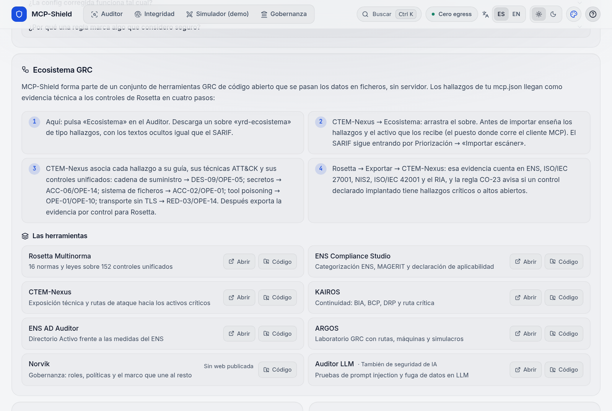</p>

| Herramienta | Qué hace |
|---|---|
| [Rosetta Multinorma](https://heindall92.github.io/rosetta_multinorma/) | 16 normas y leyes sobre 152 controles unificados |
| [ENS Compliance Studio](https://heindall92.github.io/grc_ens_compliance_studio/) | Categorización ENS, MAGERIT y declaración de aplicabilidad |
| [CTEM-Nexus](https://heindall92.github.io/ctem-nexus/) | Exposición técnica y rutas de ataque hacia los activos críticos |
| [KAIROS](https://heindall92.github.io/kairos/) | Continuidad: BIA, BCP, DRP y ruta crítica |
| [ENS AD Auditor](https://heindall92.github.io/ens_ad-auditor/) | Directorio Activo frente a las medidas del ENS |
| [ARGOS](https://heindall92.github.io/argos-grc/) | Laboratorio GRC con rutas, máquinas y simulacros |
| [Norvik](https://github.com/heindall92/Norvik_Gobernanza) | Gobernanza: roles, políticas y el marco que une al resto |
| [Auditor LLM](https://heindall92.github.io/auditor_llm/) | Seguridad de IA: pruebas de *prompt injection* y fuga de datos |

##  Novedades

| Versión | Qué cambia |
|---|---|
| **1.5.0** | Regla **MCPS-SC-004**: imágenes de contenedor sin fijar por digest (alta con `latest` y `--pull always`), aviso en el veredicto de endurecimiento y README con el formato del ecosistema. |
| **1.4.0** | Siete colores de acento, medidor lineal de riesgo, severidades traducidas, sección Ecosistema GRC, SARIF con metadatos por regla y cabecera sin desbordamiento entre 768 y 1279 px. |
| **1.3.4** | Un servidor llamado `__proto__` desaparecía del análisis (nota A con un token y `npx -y evil-pkg /`) y uno llamado `constructor` tumbaba el Auditor. `npm exec`, `npm x` y `bun x` en SC-001. |
| **1.3.0** | Monitor de integridad de herramientas (RFC-001, parte web offline). |

El detalle de cada versión está en [CHANGELOG.md](CHANGELOG.md).

##  Calidad

| Suite | Pruebas | Qué comprueba |
|---|---|---|
| Reglas y producción (`rules`, `production`, `smuggling`) | 94 | Cada regla se dispara sobre los ejemplos vulnerables; falsos positivos con configuraciones de la documentación oficial (GitHub, VS Code, uvx); parser (BOM, JSONC, formatos, tamaño, entradas no objeto); ASCII smuggling sin falsos positivos con emoji normales. |
| Endurecimiento y auditoría externa (`hardening-v122`, `audit-v122`) | 42 | Contenedores por lista blanca con re-escaneo, ocultación contextual y control de salida en cada exporte, cobertura de reglas, importación `tools/list`, versión única. Cada hallazgo de la auditoría externa tiene su prueba de regresión. |
| Claves y SARIF (`keys-v134`, `sarif-v140`) | 40 | Servidores, `env` y cabeceras con nombres de `Object.prototype` (`__proto__`, `constructor`…), `npm exec`/`bun x`/`--package`, metadatos SARIF por regla y bandas de nota compartidas. |
| Imágenes (`images-v150`) | 20 | MCPS-SC-004: lectura de la imagen como Docker (opciones globales, `container run`, `--`), registros con puerto, digest, severidades, `${VAR}` y `mcp-sandbox/*`, endurecimiento y figura con un cartucho por regla. |
| Exportes (`exporters`) | 15 | SARIF validado con el esquema OASIS 2.1.0, Markdown sin inyección, remediador y Dockerfile. |
| Integridad (`integrity/*`) | 94 | Vectores de RFC 8785, importador y límites, huellas, cifrado (ida y vuelta, contraseña errónea, cabecera alterada), comparador (RFC-001 §13.1), TOFU y revisión v1.3.3. |
| Contraste, i18n y estilo (`contrast`, `i18n`, `no-grid`) | 100 | WCAG AA de cada par de colores y de los 7 acentos en los dos temas, paridad ES/EN y sin fondos de cuadrícula. |
| E2E (`scripts/e2e.mjs`, `scripts/e2e-mobile.mjs`) | — | Playwright + axe-core en todas las vistas, claro y oscuro, español e inglés, escritorio (con la cabecera a 768–1440 px) y móvil (320–430 px): acentos, ecosistema, integridad, simulador, cero peticiones externas y ningún secreto en `localStorage`. |

El [workflow](.github/workflows/pages.yml) solo publica en GitHub Pages si pasan lint, tipos, pruebas, build, comprobación de cero egress, `npm audit --omit=dev`, e2e y CodeQL; las *pull requests* pasan además *dependency review*.

##  Seguridad y privacidad

- **Sin servidor, analítica, cookies ni terceros.** Fuentes Inter y JetBrains Mono (variables, OFL 1.1) autoalojadas con Fontsource bajo `font-src 'self'`, con fuentes del sistema como respaldo; ninguna petición a otro origen. La figura «Cero telemetría» de la ayuda muestra el recuento real de peticiones externas (Resource Timing API).
- **CSP** en `<meta>`: `default-src 'self'; script-src 'self'; connect-src 'none'; worker-src 'self'; object-src 'none'; base-uri 'self'; form-action 'none'`, más `<meta name="referrer" content="no-referrer">`.
- **Secretos (mejor esfuerzo)**: los detectados —formatos conocidos y cualquier valor en posiciones sensibles (`env`, `-e KEY=VAL`, `--env`, cabeceras, parámetros de URL, valor tras `--token`/`--key`/`--password`…) salvo literales seguros— se ocultan en pantalla, SARIF, Markdown, impresión y portapapeles; la config corregida usa referencias `${VAR}`. Un control final escanea cada exportación (patrones y cadenas de alta entropía) y la bloquea si queda algo sospechoso. Ninguna detección es perfecta: revisa lo que compartes. El texto pegado nunca se guarda ni se registra. `localStorage` solo contiene `mcps-lang`, `mcps-theme`, `mcps-accent` y `mcps-onboarded`.
- **XSS**: React escapa toda salida; los exportes Markdown escapan HTML, `|` y backticks.
- **Cabeceras HTTP en GitHub Pages**: Pages no permite configurar cabeceras de respuesta ([github/pages-gem#415](https://github.com/github/pages-gem/issues/415)). GitHub ya envía `Strict-Transport-Security` (comprobado con `curl -I`), pero no es posible añadir `X-Frame-Options` ni `Content-Security-Policy` como cabecera, y `frame-ancestors` se ignora dentro de `<meta>` ([CSP3](https://www.w3.org/TR/CSP3/#meta-element)). La app no tiene acciones con estado que un *clickjacking* pueda aprovechar; si lo necesitas, sírvela tras un proxy (p. ej. Cloudflare) que añada esas cabeceras.
- Para informar de una vulnerabilidad: [SECURITY.md](SECURITY.md).

##  Limitaciones conocidas

- Las reglas son **heurísticas**: puede haber falsos positivos y negativos. No sustituye a una auditoría profesional.
- La config corregida es un **punto de partida**: sustituye las versiones `@1.0.0`, construye las imágenes `mcp-sandbox/*` con el Dockerfile generado y adapta `${VAR}` a tu cliente (`${env:VAR}` en Cursor, `${input:id}` o `envFile` en VS Code; la documentación de Claude Desktop no describe interpolación).
- El mapeo de gobernanza es **orientativo**, no una certificación.
- El análisis no se conecta a los servidores: solo ve las descripciones de herramientas que incluyas en el JSON.
- Todas las apps de `heindall92.github.io` comparten origen; por eso MCP-Shield no guarda nada sensible.

##  Estructura

```
mcp-shield/
│
├── 🧩 src/
│   ├── engine/                 Motor de auditoría (TypeScript puro)
│   │   ├── parse.ts            mcp.json, JSONC y formatos de VS Code / Cursor, con claves propias
│   │   ├── scanner.ts          12 reglas, cobertura, riesgo y nota
│   │   ├── rules/              supply chain · filesystem · secretos · tool poisoning · smuggling · util
│   │   ├── redact.ts           Ocultación contextual de secretos
│   │   ├── exportGate.ts       Control final de cada exporte
│   │   ├── remediator.ts       Config endurecida, Docker por lista blanca y veredicto
│   │   ├── sarifExporter.ts    SARIF 2.1.0 y Markdown
│   │   └── grades.ts · ownKeys.ts · governance.ts · simulation.ts · toolsImport.ts
│   ├── integrity/              Monitor de integridad: captura, huellas, cifrado, comparador, reglas, exportes
│   ├── components/             auditor · integrity · simulator · governance · help · iso · ui
│   ├── i18n/                   Textos ES/EN, preferencias (idioma, tema, acento) y almacenamiento
│   └── data/                   Escenarios, ejemplos de demo e incidentes
│
├── 🎨 palette.js               Tokens de color y acentos (Tailwind y prueba de contraste)
├── 🧪 tests/                   vitest + esquema SARIF oficial
├── 🛠️ scripts/                 e2e · e2e-mobile · capturas · readme-assets · sync-version
├── 📄 docs/                    SOURCES.md · DESIGN-REFERENCES.md · capturas e iconos del README
└── ⚙️ .github/workflows/       pages.yml (pruebas, CodeQL, dependency review y despliegue)
```

##  Licencia y créditos

Distribuido bajo licencia [MIT](LICENSE) · © 2026 Yoandy Ramírez Delgado.

Iconos [Lucide](https://lucide.dev/license) (ISC; los derivados de Feather, MIT). React, Tailwind CSS y Vite (MIT). Fuentes Inter y JetBrains Mono (SIL OFL 1.1) vía Fontsource (MIT). Figura isométrica con el kit [anatomy](https://github.com/wheresryan22/anatomy) (MIT, copiado en `src/components/iso/`). Regla MCPS-TP-003 inspirada en [NVIDIA garak](https://github.com/NVIDIA/garak) (Apache-2.0, sin copiar código). Logotipos de la tabla `mcp-shield.yaml`: [Simple Icons](https://simpleicons.org) (CC0), cuyas marcas pertenecen a sus titulares. Ver [NOTICE](NOTICE). Patrones de diseño de 21st.dev reimplementados desde cero: [docs/DESIGN-REFERENCES.md](docs/DESIGN-REFERENCES.md). Las cifras, CVE e incidentes están contrastados con fuentes primarias en [docs/SOURCES.md](docs/SOURCES.md).

MCP-Shield no está afiliado ni respaldado por Anthropic, OWASP, la NSA, ISO/IEC, la CSA ni NVIDIA. El software se ofrece «tal cual», sin garantía. Úsalo solo con configuraciones propias o autorizadas.

##  Autor

<table>
<tr>
<td align="center" width="100%" valign="top">
<br/>
<b>Yoandy Ramírez Delgado</b><br/>
<sub><b>Diseño y desarrollo de MCP-Shield</b></sub><br/>
<sub>Junior Pentester · eJPTv2 · AI Governance (ISO 42001) · SysAdmin</sub><br/><br/>
<a href="https://www.linkedin.com/in/yoandyrd92/"></a>
<a href="https://github.com/heindall92"></a>
<a href="https://yoandyramirez.com"></a>
<a href="https://profile.hackthebox.com/profile/019c5812-b4ca-7315-b12f-14db6d2b42fa"></a>
</td>
</tr>
</table>

Otras herramientas del autor: ver [Ecosistema GRC](#-ecosistema-grc).

Errores, falsos positivos o propuestas de reglas: abre una *issue*, informa de vulnerabilidades por [SECURITY.md](SECURITY.md) o escribe a <a href="mailto:yoandyramirezdelgado@gmail.com">yoandyramirezdelgado@gmail.com</a>.

---

##  English

**MCP-Shield** audits Model Context Protocol configurations (Claude Desktop, Cursor, VS Code) entirely in your browser: 12 configuration rules for supply chain (including container images not pinned by digest), filesystem, secrets and tool poisoning (including ASCII smuggling with Unicode tag characters, inspired by NVIDIA garak); a hardened `mcp.json` with `${VAR}` references; a Docker sandbox; SARIF 2.1.0 and Markdown exports; and a printable report. An offline **integrity monitor** pins an approved `tools/list` inventory (RFC 8785 canonicalisation, SHA-256 + in-memory HMAC-SHA-256), diffs new captures field by field (rules MCPS-INT-001..008) and requires explicit human approval with a TOFU checklist; it can save an AES-256-GCM encrypted baseline package (PBKDF2-SHA256, 600,000 iterations). The SARIF imports into CTEM-Nexus and reaches Rosetta as control evidence. Detected secrets are masked on screen and in every export, and a final output check blocks a download if anything secret-shaped remains (best effort, not a guarantee). Pasted text is never stored. Seven accent colours (electric blue by default), light and dark themes, ES/EN and a mobile layout.

- Live: **https://heindall92.github.io/mcp-shield/**
- Security headers: GitHub Pages cannot set response headers. HSTS is sent by GitHub; `X-Frame-Options` and header-based CSP/`frame-ancestors` are not available, so the CSP is delivered via `<meta>` (with `connect-src 'none'`) plus a `no-referrer` policy.
- Not a substitute for a professional audit. Provided “as is” under the MIT licence. Report vulnerabilities via [SECURITY.md](SECURITY.md).


